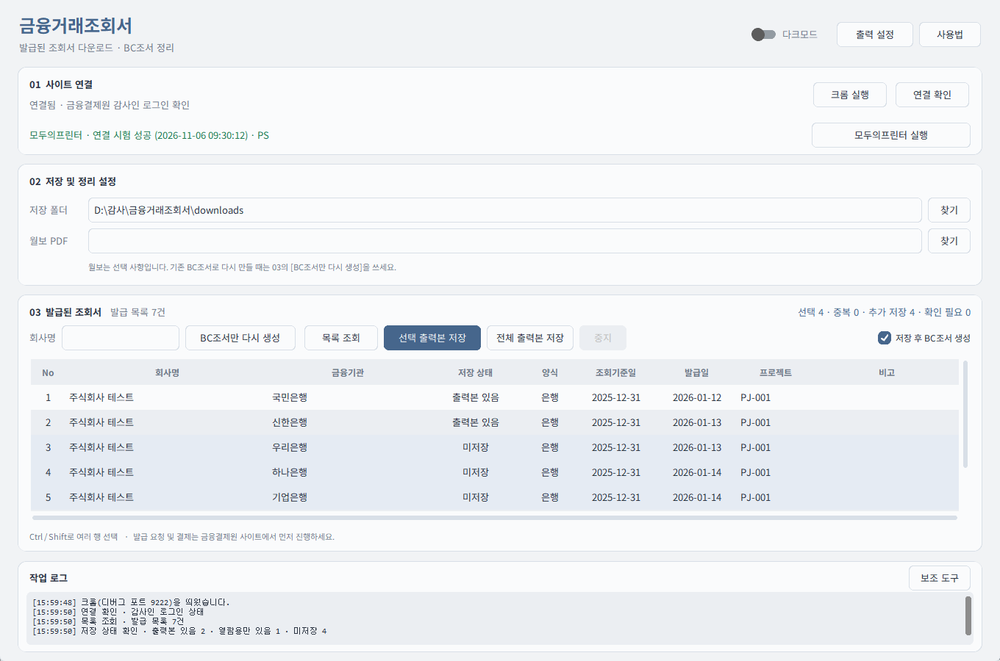
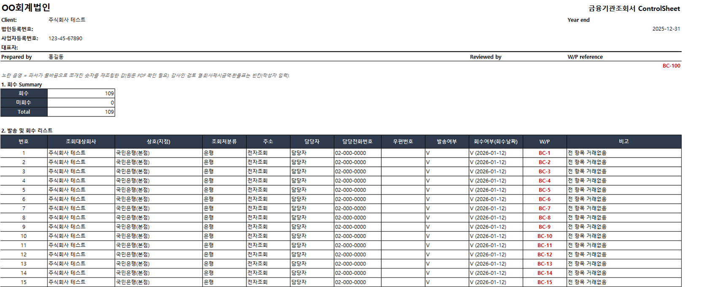
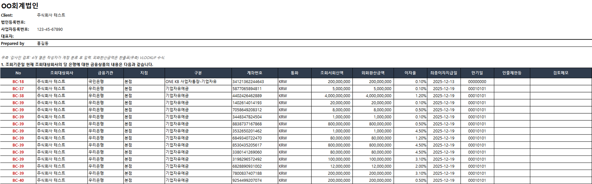

# 금융거래조회서 → BC조서 자동 정리 (kftc-confirmation-parser)

금융결제원 온라인 금융거래조회 서비스(audit.kftc.or.kr)에서 발급된 **은행·보험·보증기관 조회서**를
PDF로 모으고, 그 PDF를 읽어 감사조서용 **BC조서 엑셀(주제별 시트)** 까지 만들어 주는 Windows용 로컬 도구입니다.

> ⚠️ **아직 실제 시즌 발급 건으로 사이트 다운로드·출력 저장을 끝까지 돌려보지 못했습니다.**
> PDF → BC조서 변환은 실제 조회서로 검증했지만, 사이트 연동 부분은 모의(mock) 화면 기준입니다.
> 시즌에 보완할 항목은 아래 [미결 사항](#미결-사항--시즌에-보완할-것)에 정리했습니다.

## 왜 만들었나

감사 시즌에 금융결제원 사이트에서 조회서를 받으려면 **회사 → 금융기관 → 사업장마다 하나씩** 들어가 뷰어를 열고 저장해야 합니다.
피감회사 하나에 은행·보험·보증기관이 수십 건이면 같은 클릭을 수십 번 반복하고,
받은 PDF를 다시 열어 예적금·대출·지급보증 금액을 조서에 옮겨 적어야 합니다.

이 도구는 그 두 단계를 줄입니다.

1. **모으기** — 결제가 끝난 조회서 목록을 한 번에 불러오고, 사업장별 출력본을 **모두의 프린터(가상 PDF 프린터)** 로
   PDF 저장하는 과정을 대기열로 관리합니다. 새 PDF가 생기면 회사·사업자번호·금융기관·기준일을 읽어 맞는 건인지 대사하고,
   중복을 걸러 정해진 폴더에 보관합니다.
2. **조서 만들기** — 모인 PDF를 파싱해 BC조서(CS·완전성대사·예적금·대출금·지급보증·담보·어음수표·보증보험 등)를 만들고,
   은행연합회 월보가 있으면 대출·지급보증을 자동 대사합니다.


> 출력 뷰어의 **인쇄 버튼은 사용자가 누릅니다.** 프로그램은 어떤 건을 인쇄할 차례인지 안내하고, 생성된 PDF를 확인·보관합니다.
> (인쇄 버튼 자동 조작은 실제 시즌 화면을 확인한 뒤 넣을 예정)

## 화면

GUI (가짜 데이터로 띄운 예시 화면)



생성되는 BC조서 — CS(Control Sheet)



BC조서 — 예적금 시트 (회사명·계좌번호·금액 모두 가짜 값)



## 주요 기능

| 기능 | 설명 |
|---|---|
| 조회서 파싱 | 텍스트 PDF/zip에서 머리(회사·기준일·감사인)와 항목별 표(예적금·대출·지급보증·담보·어음수표·파생·보증보험 등)를 추출 |
| BC조서 생성 | CS · 완전성대사 · 월보대사 · 예적금 · 유가증권 · 대출금 · 지급보증 · 파생상품 · 담보제공 · 어음수표 · 담보보증내역 · 보증보험 · 원본추출 · OCR판독(스캔본 있을 때) · 처리로그 시트 |
| 월보 대사 | 은행연합회 신용공여 월보 PDF를 읽어 기관별 대출·지급보증을 조회서 금액과 자동 대사 |
| 누적 재생성 | 조회서가 추가되면 새 버전(`_vN`)을 만들고 이전 버전에 직접 입력한 검토값을 옮김. BC번호는 고정 |
| 사이트 연동 GUI | 크롬 실행 → 로그인 확인 → 기발급 목록 조회 → 출력본 저장·대사 |

## 설치 요건

| 항목 | 필요한 경우 | 비고 |
|---|---|---|
| Windows 10/11 | 항상 | GUI·프린터 연동이 Windows 전용(pywin32) |
| Python 3.11 이상 | 항상 | 설치 시 "Add python.exe to PATH" 체크 |
| Python 패키지 | 항상 | `pip install -r requirements.txt` |
| Google Chrome | 사이트 연동 | 기본 경로 `C:\Program Files\Google\Chrome\Application\chrome.exe` (다르면 `크롬실행.cmd` 수정) |
| 금융결제원 감사인 공동인증서 | 사이트 연동 | 로그인은 사용자가 직접 |
| 모두의 프린터 + PS 프린터 | 출력본 저장 | 사이트 출력 뷰어로 인쇄한 조회서를 텍스트가 있는 PDF로 받기 위해 사용 (아래 참고) |
| Ghostscript | 모두의 프린터 3.53 이상에서 PS 프린터 사용 시 | 아래 참고 |

> 이미 받아 둔 조회서 PDF/zip을 정리만 할 때(`run_parser.py`)는 Python과 패키지만 있으면 됩니다.
> `playwright`는 이미 실행 중인 크롬(디버그 포트)에 붙기만 하므로 `playwright install`(브라우저 다운로드)은 필요 없습니다.

### 1) Python 패키지
```
pip install -r requirements.txt
```

### 2) 모두의 프린터 설치·설정

무료 가상 PDF 프린터입니다. 이 도구는 출력본 PDF에서 **텍스트를 읽어** 회사·사업자번호·금융기관·기준일을 대사하므로,
반드시 **PS(PostScript) 방식 프린터**로 인쇄해야 합니다. 3.50 이후 기본 프린터(HP PCL)로 만든 PDF에는 텍스트가 없어 대사가 되지 않습니다.

1. **다운로드** — 공식 페이지 https://modu-print.com/모두의-프린터-다운로드/ 에서 PC에 맞는 64비트/32비트 버전을 받습니다.
   설치 프로그램 없이 실행파일 하나로 동작하며, 회원가입·결제가 없습니다.
   다운로드·실행 시 Windows Defender나 크롬이 막으면 같은 페이지의 예외처리 안내를 따릅니다.
2. **실행** — 실행파일을 실행하면 가상 프린터가 구성됩니다(이 도구의 [모두의프린터 실행] 버튼은 Windows 관리자 승인 창을 띄웁니다).
3. **PS 프린터 설치** — 모두의 프린터 환경설정 → `프린터` → `프린터 설치` 목록에서 이름이 **`... PS`** 로 끝나는 프린터를 체크하고
   `체크한 프린터 설치`를 누릅니다. (개발 시 검증한 조합: `Samsung CLX-6240 Series PS`)
4. **Ghostscript 연결 (3.53 이상)** — PS 프린터는 Ghostscript로 PDF를 만듭니다.
   - https://ghostscript.com/releases/gsdnld.html 에서 PC 비트에 맞는 Ghostscript를 받아 설치
   - 모두의 프린터 메뉴 `파일` → `Ghostscript 경로지정` → Ghostscript 설치 폴더의 `bin\gswin64c.exe`(32비트는 `gswin32c.exe`) 선택
   - **이름 끝에 `c`가 있는 파일**을 고르세요. `gswin64.exe`를 고르면 모두의 프린터가 응답 없음이 됩니다.
   - 메뉴 앞에 체크 표시와 로그로 지정 여부를 확인합니다.
5. **저장 폴더** — 기본은 `문서` 폴더(파일명 기본 `MOP`)입니다. 환경설정의 `저장폴더변경`으로 바꿀 수 있습니다.
6. **이 도구와 연결** — GUI 상단 `출력 설정`에서 ①모두의 프린터 실행파일 ②모두의 프린터 저장 폴더(5번과 같은 곳) ③PS 프린터를 지정하고
   `연결 시험`을 누릅니다. 시험 문서가 PDF로 생성되고 고유 문구가 텍스트로 읽히면 상단에 **연결 시험 성공**이 표시됩니다.
   저장 폴더·프린터를 바꾸면 다시 시험해야 합니다.

출처: 모두의 프린터 공식 페이지 — [다운로드](https://modu-print.com/모두의-프린터-다운로드/),
[3.53 업데이트(PS 프린터 + Ghostscript)](https://modu-print.com/업데이트/모두의-프린터-3-53-업데이트/),
[3.60 업데이트](https://modu-print.com/업데이트/모두의-프린터-v3-60-업데이트/),
[기능 설명서](https://modu-print.com/사용설명서/기본설치-및-사용법/모두의-프린터-기능-설명서/) (2026-11 확인).
개발 중 실제 시험은 3.49(64비트) + `Samsung CLX-6240 Series PS`로 했고, 3.53 이상 + Ghostscript 조합은 공식 안내 기준입니다.

### 3) 크롬
`크롬실행.cmd`가 디버그 포트 9222와 별도 프로필(`%USERPROFILE%\chrome-kftc`)로 금융결제원 사이트를 엽니다. 평소 쓰는 크롬 프로필과 섞이지 않습니다.

## 사용법

### GUI
`실행.bat` 더블클릭

1. **크롬 실행 → 사이트에서 공동인증서 로그인 → 연결 확인 → 목록 조회**
2. 행을 선택해 출력본을 저장하면 PDF를 대사·보관하고 BC조서를 만듭니다.
3. 다시 만들 때는 03 구역의 **[BC조서만 다시 생성]** → 회사 선택 → 기존 BC조서 엑셀을 끌어다 놓거나 경로 붙여넣기.
   그 회사 출력본만으로 새 버전(`_vN`)을 만들고 기존 파일의 입력값을 옮깁니다(기존 파일은 덮어쓰지 않음, BC번호 유지).
4. 화면 오른쪽 위 **[사용법]** 에서 단계별 안내를 볼 수 있습니다.

### CLI
```
python 프로그램\run_parser.py "<조회서 PDF 폴더>"          # BC조서 생성
python 프로그램\run_parser.py "<폴더>" --wolbo "<월보.pdf>"  # 월보 대사 포함
python 프로그램\run_kftc.py --help                         # 사이트 목록·다운로드
```
결과: `<폴더>_정리\BC조서_<회사>_vN_<일시>.xlsx`

## 폴더 구조

| 위치 | 내용 |
|---|---|
| `프로그램/` | 파서(`confirm_parser`, `wolbo_parser`), 엑셀 작성(`excel_writer`, `carry_over`), 사이트 엔진(`kftc_engine`), GUI(`kftc_gui_v3`가 최신, v1·v2는 상속 기반) |
| `tests/` | 가짜 데이터·mock HTML 기반 단위 테스트 (`테스트실행.bat`) |
| `downloads/`, `설정/` | 실행 시 생성. 조회서·조서·설정 저장 위치(커밋 제외) |

## 제한 사항

- 스캔(이미지) PDF는 Windows 내장 한국어 OCR(`winocr`)로 읽어 **OCR판독 시트에 추정값으로만** 보여 줍니다('해당사항 없음' 문구 수·금액 후보). 금액 시트에는 자동으로 넣지 않으니 원문으로 확인해 직접 입력하세요. `--no-ocr`로 끌 수 있습니다.
- 변호사조회서는 '대상 아님', 회사가 보낸 요청 서식(비은행 금융회사용 등)은 '발송본(회신 아님)'으로 따로 표시합니다.
- zip 안 PDF는 모두 읽고, 폴더와 zip에 같은 내용 PDF가 있으면 한 번만 넣습니다.
- 일부 기관(PDF 미제공, 뷰어 전용)은 별도 처리가 필요합니다.
- 사이트 화면 구조가 바뀌면 `kftc_engine`의 목록 파서를 조정해야 합니다.
- 실제 조회서 PDF를 쓰는 회귀 테스트는 고객 자료 보호를 위해 저장소에 포함하지 않았습니다.

## 미결 사항 — 시즌에 보완할 것

금융결제원 기발급 목록은 **발급일로부터 약 3개월만 보존**되어, 개발 시점(비시즌)에는 실제 목록이 0건이었습니다.
그래서 아래 항목은 감사 시즌(보통 1~3월)에 실제 발급 건으로 확인·보완해야 합니다.
Claude Code·Codex 등 AI 에이전트로 작업한다면 [AGENTS.md](AGENTS.md)에 같은 내용과 작업 순서가 있습니다.

| # | 항목 | 현재 상태 | 시즌에 할 일 |
|---|---|---|---|
| 1 | 발급 목록·사업장 목록 화면 파싱 | 사이트 조사 결과로 만든 mock HTML 기준 | GUI `보조 도구 → 화면 구조 저장`으로 실제 화면을 덤프해 `kftc_engine.parse_paid_list` / `parse_site_list` 보정 |
| 2 | PDF 생성요청 → 상태확인 → 다운로드 | 요청 흐름만 구현, 실응답 미확인 | 1~2건으로 응답 형식(zip 여부·파일명 헤더·대기시간) 확인 |
| 3 | 출력 뷰어 → 모두의 프린터 저장 | 시험 인쇄로만 검증 | 실제 조회서 인쇄 → PDF 감지·대사·보관 확인. 가능하면 인쇄 버튼 자동화 검토 |
| 4 | 상세 화면의 엑셀저장 | 존재만 확인 | 내용이 PDF 파싱을 대신할 수 있는지 확인 |
| 5 | 증권회사·카드사 양식 | 증권회사 금결원 양식 1종·카드사 자체 양식 1종(법인카드) 지원 | 다른 증권사·카드사 양식은 샘플 확보 시 추가 |
| 6 | PDF를 주지 않는 기관(뷰어 전용) | 'PDF미제공'으로 표시만 | 모두의 프린터 경로로 받을지 결정 |
| 7 | 스캔(이미지) PDF | OCR 추정(OCR판독 시트), 자동 기입 없음 | 금융기관별 회신 양식이 달라 표 자동 추출은 미정 |
| 8 | 모두의 프린터 3.53 이상 + Ghostscript | 공식 안내 기준(미실측) | 실제 PC에서 연결 시험 |
| 9 | 월보 기관명 매칭 | 일부 별칭만 등록 | '월보에 없음'이 뜨는 기관명을 `wolbo_parser._ALIASES`에 추가 |

## 주의

조회서·월보·BC조서에는 고객 정보가 들어 있습니다. `.gitignore`가 PDF·zip·엑셀·이미지를 막아 두었으니
결과물을 저장소 폴더 안에 두더라도 커밋하지 마세요.
